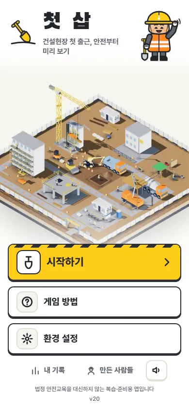
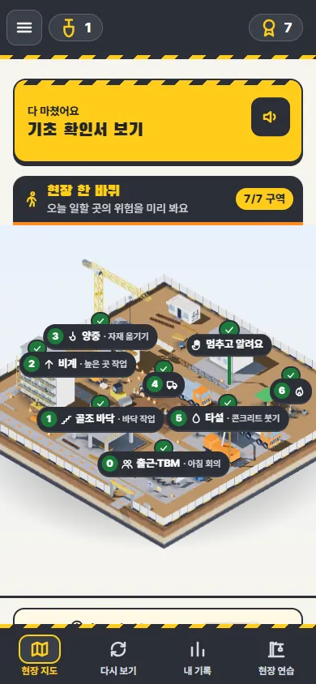
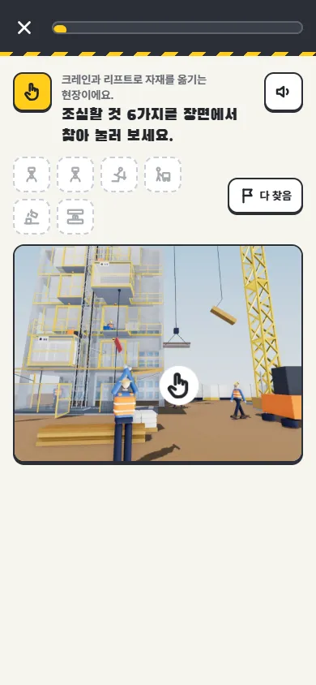

# 05. 시스템 구현

## 5.1 구조
첫 삽은 서버 없는 정적 웹앱(PWA)이다. GitHub Pages에서 배포하며, 서비스 워커가 첫 방문 때 핵심 파일 93개를 저장해 이후에는 인터넷 없이 실행된다. 학습 기록은 기기의 localStorage에만 저장하고 외부로 보내지 않는다. 연구 자료가 필요하면 사용자가 "결과 파일 저장"으로 직접 내보낸다.

**표 5-1. 구성 요소**

| 층 | 구성 | 파일 | 비고 |
|---|---|---|---|
| 화면 | 타이틀·소개·설정(`title.js`), 학습 흐름(`app.js`), 아이콘(`icons.js`, 직접 그린 SVG), 캐릭터(`mascot.js`) | `js/learn/` 약 430KB | 프레임워크 없이 DOM 직접 생성 |
| 3D | three.js r170(MIT), 현장 지도·장면(`site3d.js`, `scene3d.js`), 코드 모델(건설용 리프트·작업자·안전시설 `models/`) | `vendor/`, `js/learn/models/` | 그리기 전 셰이더 병렬 컴파일, 느린 기기는 미리 렌더링 그림 |
| 미리 렌더링 | 구역 장면·비교 그림 쌍·지도 그림(WebP) + 누를 곳 좌표 | `assets/scenes/`, `data/prerender.json` | 빌드 때 같은 3D 코드로 생성 → 저사양에서도 같은 그림 |
| 데이터 | 레슨(`lessons.json`), 위험 장면(`scenes.json`), 출처(`sources.json`), 그림 기록(`media.json`), 문구(`locales/ko-learn.json`) | `data/` 약 156KB | 교육 내용과 코드 분리 |
| 글꼴 | Pretendard 공식 동적 서브셋(OFL, 92조각, 화면 글자 조각만), Black Han Sans(OFL) | `fonts/` | 첫 화면 약 110KB |
| 오프라인 | 서비스 워커 | `sw.js` | 버전 이름으로 캐시 교체 |
| 부록 | 3D 현장 연습 게임(시제품) | `game.html`, `js/*.js` | 연구 범위 밖, 기초를 마치면 열림 |

**그림 5-1~5-9.** 앱 화면(`그림/` 폴더): 5-1 타이틀, 5-2 현장 한 바퀴 지도, 5-3 미리 보기, 5-4 상황 읽고 찾기, 5-5 어떻게 할까, 5-6 결과와 현장 안전 카드, 5-7 그림 점검, 5-8 사용 설문, 5-9 TBM 큰 글씨.

  

## 5.2 학습 흐름
**그림 5-10. 학습 흐름(텍스트 도식)**
```
오프닝 → 타이틀 ─ 시작하기 ─→ 소개 4장 → 보기 방식(글과 그림 / 그림만) → 사전 그림 점검(6) → 첫 출근
                 └ 이어하기 ─→ 현장 한 바퀴 지도
지도 → 구역 k: 미리 보기 → 상황 읽고 찾기(위험 3~6, 함정) → 어떻게 할까 → 결과·안전 카드 → 구역 k+1
7구역 끝 → 멈추고 알려요(순서 3) → 사후 그림 점검(6) → 사용 설문(선택) → 기초 확인서
```

## 5.3 위험 장면 제작 방법
1. `scenes.json`에 위험마다 이름·상황 문장·안전 문장·정답 행동·출처 id를 적는다(문장은 원문 대조 뒤 `원문확인`).
2. 3D 장면은 코드로 짓는다. 위험 하나당 "위험한 부품"과 "안전한 부품"을 같은 자리에 두고 켜고 끄는 방식으로, 같은 구도에서 차이 하나인 그림 쌍을 만든다(DP3).
3. 누를 곳은 위험 부품의 3D 경계 상자 중심을 화면 좌표로 바꿔 자동으로 정한다.
4. `tools/render-scenes.mjs`가 같은 코드로 구역 장면·그림 쌍·지도를 WebP로 렌더링하고 좌표를 `prerender.json`에 쓴다.
5. 명료성 규칙 7가지로 점검하고(`위험장면_명료성_점검.md`), 3초 시험으로 자체 검수한다(`장면검수.md`).

## 5.4 성능 최적화(라운드 1)
**표 5-2. 첫 화면 성능 개선(느린 4G·CPU 4배, 같은 조건 비교)**

| 항목 | 전 | 후 | 방법 |
|---|---|---|---|
| 타이틀 단추가 보일 때까지 | 23.1초 | 3.1초 | HTML 안 정적 오프닝, 비차단 CSS, 데이터 동시 요청, 모듈 미리 받기 |
| 첫 실행 받는 양 | 5.7MB | 0.65MB | 글꼴 전체(2.0MB) → 공식 동적 서브셋, three.js 압축판, 교육 앱 문구만 분리 |
| Lighthouse 성능 | 33 | 64~76 | 위 + 첫 실행 타이틀은 그림, 3D는 두 번째 실행부터 |
| 3D 긴 작업 합 | 5.4초 | 1.3초 | 셰이더 병렬 컴파일, 환경광 먼저, 그림자 필요할 때만 |

## 5.5 개인정보와 연구 자료
결과 파일 항목: 무작위 번호, 앱·데이터 버전, 사전·사후 점수와 문항별 정오, 구역별 찾은 수·비율·시간·별·잘못 누른 수, 멈추고 알려요 기록, 사용 설문 답과 SUS 점수, 사용 시간대(시). 이름(확인서에 적는 이름 포함)·연락처·기기 정보·위치는 담지 않는다.
