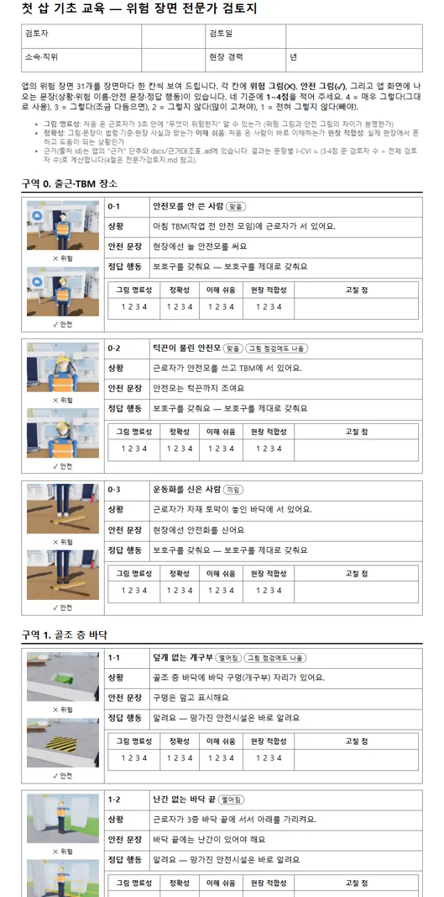

# 06. 교육 내용과 근거 체계

## 6.1 교육 내용 구성
본 과정은 현장 한 바퀴 7구역의 위험 30개와 마무리 "멈추고 알려요"로 이루어진다. 구역은 신규 근로자가 출근해서 만나는 동선(출근·TBM → 골조 → 외부 비계 → 양중 → 장비·토공 → 타설 → 용접·밀폐·폭염)을 따른다. 구역마다 이미 안전하게 된 곳(함정) 1곳을 두어 아무 데나 누르는 것을 막았다. 기초 레슨 6개(v11, 법정 교육 [별표 5] 내용과 연결)는 글로 더 알아보고 싶은 사람을 위한 선택 과정으로 남겼다.

**표 6-1. 구역별 위험 수**

| 구역 | 이름 | 위험 | 함정 |
|---|---|:-:|:-:|
| 0 | 출근·TBM 장소 | 3 | 1 |
| 1 | 골조 층 바닥 | 5 | 1 |
| 2 | 외부 비계·고소작업대 | 5 | 1 |
| 3 | 양중·크레인·리프트 | 6 | 1 |
| 4 | 장비·토공사 | 4 | 1 |
| 5 | 타설·동바리 | 4 | 1 |
| 6 | 용접·밀폐공간·폭염 | 4 | 1 |
| 계 | | **31** | 7 |

**표 6-2. 위험 종류별 수(재해 유형 분류)**

| 떨어짐 | 무너짐 | 맞음 | 끼임 | 부딪힘 | 감전 | 넘어짐 | 찔림 | 불 | 질식 | 더위 |
|:-:|:-:|:-:|:-:|:-:|:-:|:-:|:-:|:-:|:-:|:-:|
| 7 | 6 | 5 | 3 | 3 | 2 | 1 | 1 | 1 | 1 | 1 |

떨어짐이 가장 많은 것은 사고사망 유형에서 떨어짐이 가장 많다는 통계(1장 [1])와 방향이 같다. 다만 위험 수의 배분은 통계 비율에 맞춘 것이 아니라 구역별 대표 위험을 고른 결과다.

**표 6-3. 위험별 정답 행동**

| 행동 | 뜻(앱 문장) | 위험 수 |
|---|---|:-:|
| 알려요(tell) | 망가진 안전시설은 바로 알려요 | 13 |
| 멈춰요(stop) | 급박한 위험이면 멈추고 피해요 | 11 |
| 보호구(ppe) | 보호구를 제대로 갖춰요 | 6 |
| 피해요(away) | (3-6 리프트 방호울 — "어떻게 할까" 선택지에 없어 묻지 않음) | 1 |

## 6.2 근거 체계
교육 화면의 모든 사실 문장은 출처 id와 검증 상태를 가진다.

**표 6-4. 출처 등급과 사용 범위**

| 등급 | 종류 | 앱 화면 | 출처 수 |
|---|---|---|:-:|
| 1 | 법령·고시 원문(법률, 고용노동부령, 고용노동부 고시) | 사용 | 38 |
| 2 | 공공기관 공식 자료(안전보건공단 기본서, 고용노동부 보도자료, 서울시) | 사용 | 27 |
| 3 | 국가 표준(KCS, KS 인증심사기준) | 사용 | 4 |
| 4 | 학술 논문 | 문서에만 | — |
| 5 | 뉴스·업체 설명 | 사용 안 함(단서로만) | — |
| 계 | | | **69** |

**그림 6-1. 문장 상태 흐름**
```
초안 ──(원문 PDF와 인용 조각 대조, check-sources.py 일치)──▶ 원문확인 ──(전문가 검토 I-CVI 기준 충족)──▶ 전문가확인
 └ 화면에 안 보임(?dev=1에서만 노란 테두리)        └ 화면에 보임, "근거" 칩      └ 화면에 "전문가 확인" 표시
```

- **원문 대조.** 출처마다 원문의 인용 조각(quote)을 `sources.json`에 저장하고, `tools/check-sources.py`가 원문 파일(공개 저장소 밖 `참고자료/`)에서 같은 조각을 찾는다. 2026-11-25 기준 출처 69개, 인용 129조각, 불일치 0.
- **화면 점검.** smoke 3번이 화면의 사실 문장(장면 70 + 레슨 87)에 출처가 모두 있는지, 초안이 화면에 나오지 않는지 확인한다. 출처 없는 문장 0, 화면 초안 0.
- **현재 상태.** `scenes.json`의 위험 문장(이름·안전 문장·상황 문장 93개)은 모두 `원문확인`이며 `전문가확인`은 0이다.

## 6.3 상황 문장의 근거 표기
상황 문장("골조 층 바닥에 바닥 구멍(개구부) 자리가 있어요")은 그림을 설명하는 문장이다. 지금은 해당 위험의 출처와 같은 id를 달아 두었는데, 원문에 그 장면이 그대로 있는 것은 아니다. 논문에서는 상황 문장을 "출처의 위험 요인을 장면으로 옮긴 설명"으로 구분해 적는다(채점표 E 감점 사유).

## 6.4 전문가 검토 계획
- 도구: 위험 장면 30개 검토지(`docs/전문가검토지_장면.html`, 그림 쌍 + 문장 4종 + 4점 척도 4기준: 그림 명료성·정확성·이해 쉬움·현장 적합성), 멈추고 알려요, 그림 점검 의견.
- 검토자: 현장 안전관리자·교수 3~5명, 각자 따로.
- 분석: 문항별 I-CVI = 3·4점을 준 검토자 수 ÷ 검토자 수, 기준별로. 전체 S-CVI/Ave. 기준값(Lynn, 1986; Polit & Beck, 2006)은 원문 확인 전이라 "문헌상 권장"으로만 쓴다.
- 반영: I-CVI가 낮은 문장·그림은 의견대로 고친 뒤 다시 원문 대조, 기준을 넘은 문장만 `전문가확인`.

**그림 6-2. 위험 장면 전문가 검토지(첫 쪽)**


