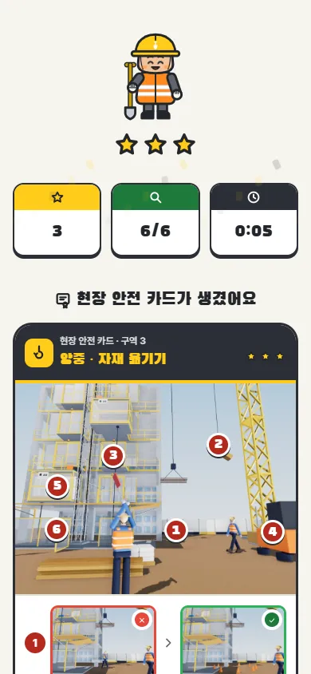
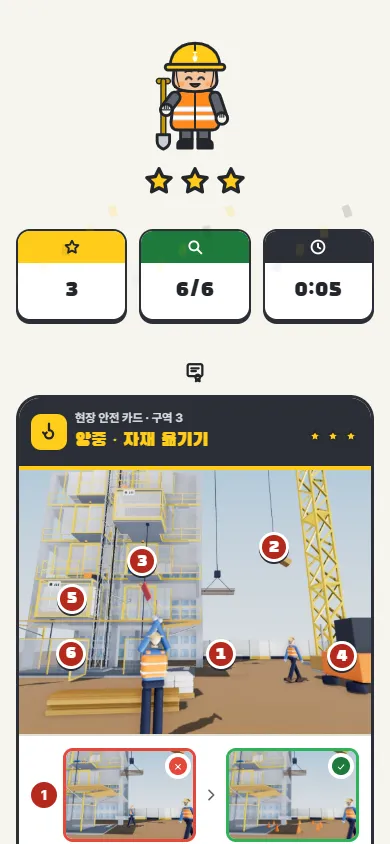
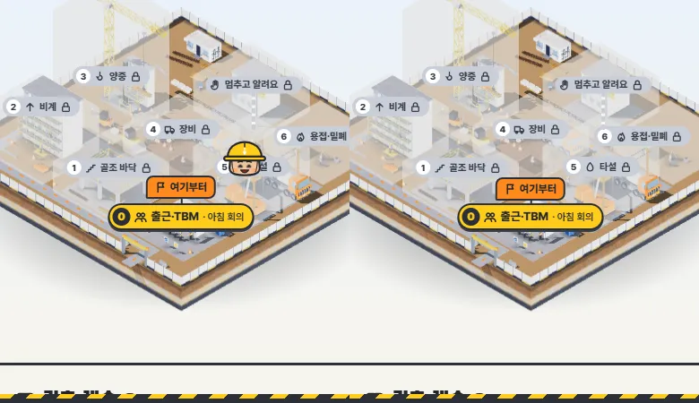

# 08. 개발 과정: 반복 설계와 점검

## 8.1 버전별 설계 변화
개발은 2026-10-26부터 11-25까지 약 한 달, v1에서 v20까지 반복했다. 버전마다 바뀐 점과 이유는 `CHANGELOG.md`에 있고, 아래는 설계 방향이 바뀐 지점만 고른 것이다.

**표 8-1. 주요 설계 전환**

| 버전(날짜) | 바뀐 것 | 이유 |
|---|---|---|
| v1~v8(10/26~11/2) | 3D 블록 건설 게임, 학생·현장 두 트랙, 미니게임 | 에이전트 앱 과제에서 출발, 캡스톤 주제화 |
| v9~v10(11/13) | 목적·대상 재정의: 신규 근로자 한 트랙, 한국어 우선, "무슨 작업·왜 위험·근거" 표시 | 목적을 "작업을 알면 위험이 보인다"로 좁힘 |
| v11(11/16) | **처음부터 재설계**: 기초 교육 우선(레슨 6개, 사전·사후 점검), 게임은 2단계 "현장 연습" | 교육에 긴 시간을 쓸 수 없는 신규 근로자 |
| v11.1~11.2(11/16) | **근거 검증 체계**: 문장마다 출처 id·상태, 원문 대조, 표준·고시 반영 | 내용 신뢰(DP6) |
| v12~v12.3(11/16~17) | 디자인 체계(안전 표지 4색 의미, 직접 그린 아이콘, 캐릭터) | 일관성 |
| v13(11/17) | **현장 위험 찾기 7구역**(위험 29개·함정 7개), 위험/안전 그림 쌍 | 글보다 장면으로(DP3) |
| v14~v15(11/17) | 3D 현장 지도, 그림과 글 함께(그림 모드 제거 — 지도교수 의견), 상황 문장 | 그림과 글의 관계 |
| v16(11/22) | 위험 장면 명료성 규칙 7가지로 29곳 다시 만듦 | "무엇이 위험한지 한눈에" |
| v17(11/22) | **먼저 알고 → 찾고 → 정리**, 현장 안전 카드, 아이소메트릭 지도 | 처음 보는 사람의 무작위 누르기(DP2) |
| v18~v19.4(11/24) | 0원 3D 고도화(코드 모델·CC0), 미리 렌더링, 건설용 리프트 재제작(별표 3 기준), 위험 31개 | 그림 품질·저사양 대응 |
| v20(11/24~25) | 인트로·메인 메뉴·설정, **심사단 점검 라운드 1~5** | 외부 심사 관점의 품질 점검 |

## 8.2 심사단 점검(라운드 1~5)
v20에서는 외부 심사위원 다섯 관점(① 지도교수·논문, ② 현장 안전관리자, ③ 처음 온 근로자, ④ 한국어 글을 못 읽는 외국인 근로자, ⑤ 교육 앱 UX)으로 11개 기준(A~K)을 1~5점으로 채점했다. 4점 이상은 "외부 심사위원이 봐도 지적할 것이 없음"으로 정하고, 증거가 없으면 점수를 올리지 않았다. 라운드마다 새 문제를 5개 이상 찾고, 고친 뒤 자동 점검(최대 136화면 × 2모드)으로 회귀를 확인했다. 비용은 0원이며 무료 도구(Lighthouse, axe-core, Chrome DevTools Protocol, puppeteer)만 썼다.

**표 8-2. 라운드별 결과**

| 라운드 | 주제 | 새 문제 | 대표 결과 | 평균 점수 |
|---|---|:-:|---|:-:|
| 1 | 측정·성능·접근성 | 13 | 첫 화면 23.1→3.1초, 접근성 위반 151→0 | 2.6→2.7 |
| 2 | 연구 도구 | 7 | 앱 안 SUS·자체 설문, 진행 문서, 장면 검토지 | 2.8 |
| 3 | 그림만 모드 규칙 | 7 | 그림만 모드 찾기 화면 한글 0자 | 2.9 |
| 4 | 탐색·안내 | 8 | 뒤로 가기 6가지, 게임 방법 7장 | 2.9 |
| 5 | 격리·현장 연계·색약 | 8 | 외부 요청 11→0, 이름표 겹침 4→0, TBM 큰 글씨, QR 포스터 | 2.9 |
| 6(문서) | 논문자료 | 5 | 정답 행동이 선택지에 없는 위험(3-6) 버그 발견·수정, 논문자료 01~10 | 3.0 |

**표 8-3. 채점 기준별 점수(라운드 1 → 6)**

| 기준 | 1 | 6 | 4점이 되려면 |
|---|:-:|:-:|---|
| A 첫인상 | 3 | 3 | 처음 보는 사람 5초 테스트 |
| B 교육 설계 | 3 | 3 | 본 과정 하나로 정리, 실제 TBM 사용 |
| C 장면 명료성 | 3 | 3 | 외부인 3초 시험 |
| D 현장 정확성 | 2 | 2 | 전문가 검토 |
| E 근거 신뢰성 | 3 | 3 | 전문가 확인, 상황 문장 표기 |
| F 접근성 | 2 | 3 | 외국인 시험, TalkBack |
| G 게임성 | 3 | 3 | 성취를 학습과 묶기 |
| H 일관성 | 3 | 3 | 현장 연습 안의 이모지·용어 |
| I 성능 | 3 | 3 | Lighthouse 90, 지도 30fps, 실기기 |
| J 연구 준비 | 2 | 3 | 예비 시험 자료 |
| K 논문 적합성 | 2 | 3 | 본 문서 01~10 작성(라운드 6) — 결과 장은 예비 시험 뒤 |

4점에 닿지 못한 이유는 대부분 사람이 해야 하는 확인(전문가 검토, 사용자 시험, 실기기)이 남았기 때문이다. 이는 개발 단계의 자동 점검만으로는 교육 도구의 품질을 보장할 수 없다는 점을 보여 준다.

**그림 8-1·8-2. 그림만 모드 결과 화면(라운드 1 전 → 라운드 5 후)**

 

**그림 8-3. 지도 이름표(왼쪽: 고치기 전 — 캐릭터에 가림·오른쪽 끝 잘림, 오른쪽: 라운드 5 후)**

## 8.3 AI 도구 사용
코드 작성, 측정 도구 실행, 자료 정리, 문서 초안에 AI 코딩 도우미(Claude, Anthropic)를 썼다. 무엇을 만들지, 우선순위, 교육 내용의 방향, 최종 확인은 연구자가 정했다. 교육 문장의 근거 확인은 원문 자동 대조를 거쳤고 전문가 확인은 아직 없다. 날짜별 사용 내역과 사람이 확인해야 할 AI 판단은 `docs/AI_사용기록.md`에 있다.
