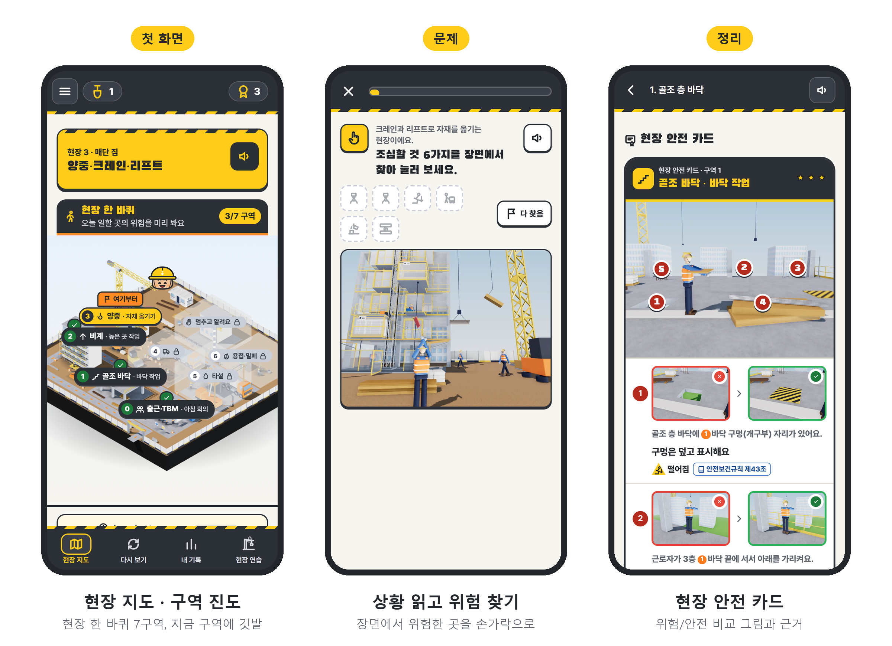
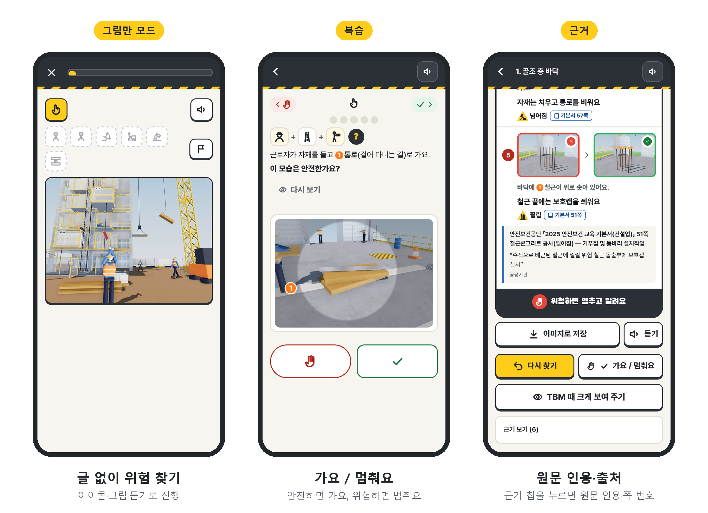

# 첫 삽 — 진행 상황 (2026-11-25)

## ① 한 줄 요약

**건설현장 첫 출근 전, 위험한 곳과 그 이유를 그림으로 미리 익히는 교육 앱**

- 배포 주소: https://wldp2003-ctrl.github.io/first-shovel/
- 현재 버전: v20 (2026-11-25 배포)

## ② 무엇을 하는 앱인가

- 출근 전 휴대폰으로 한다. 구역 하나에 1.4–4.8분, 7구역 전체는 15–28분이 걸린다(자동 점검으로 낸 추정, 사람 측정 아님).
- 현장 한 바퀴 7구역을 돈다: 출근·TBM, 골조 바닥, 비계, 양중, 장비·토공, 타설, 용접·밀폐·폭염.
- 구역마다 미리 보기 → 상황 문장 읽고 위험 찾기 → 어떻게 할까 → 현장 안전 카드 순서로 진행한다.
- 그림만 모드(글을 숨기고 아이콘·그림으로 진행)와 듣기(기기 음성으로 읽어 주기)를 지원한다.
- 사전·사후 그림 점검(6문제)과 사용 설문(SUS 10문항 + 자체 5문항)이 앱 안에 있다.
- 법정 안전교육을 대신하지 않고, 복습·준비용입니다.

## ③ 누가 쓰나

| 사용자 | 언제 | 무엇을 얻나 |
|---|---|---|
| 건설현장 신규·초보 근로자(일용직 포함) | 출근 전, 현장 대기 중 | 오늘 일할 구역의 위험을 그림으로 미리 보고 직접 찾아본다 |
| 글을 읽기 어려운 외국인 근로자 | 출근 전 | 그림만 모드·듣기 (음성은 한국어만 — 한계) |
| 반장·관리감독자 | TBM | 현장 안전 카드 이미지, TBM 때 크게 보여 주기 화면 |

- 실제 사용자 시험은 아직 0명이다 (예비 시험 12/1–4 예정).

## ④ 휴대폰에서 보면

- 첫 화면 · 현장 지도 / 문제 · 상황 읽고 위험 찾기 / 정리 · 현장 안전 카드 (위험/안전 비교 그림과 근거)

- 그림만 모드 · 글 없이 위험 찾기 / 복습 · 가요 / 멈춰요 / 근거 · 근거 칩을 누르면 원문 인용과 쪽 번호

(캡처: 배포본을 390×844, 3배 해상도로 열어 예시 기록 — 구역 3개 완료 — 을 넣고 찍음)

## ⑤ 앱 안의 단계

흐름: 오프닝 → 메인 메뉴(타이틀) → 소개 4장 → 보기 방식 고르기 → 사전 점검 → 첫 출근 → [구역: 미리 보기 → 상황 읽고 찾기 → 어떻게 할까 → 결과·안전 카드] × 7 → 멈추고 알려요 → 사후 점검 → 사용 설문(건너뛸 수 있음) → 기초 확인서

| 단계 | 화면에서 하는 일 | 왜 이 단계가 있나 |
|---|---|---|
| 메인 메뉴 | 시작하기·이어하기, 게임 방법 7장, 환경 설정, 내 기록, 만든 사람들 | 어디서 멈춰도 이어서 하게 |
| 소개 4장 | 앱이 무엇인지, 현장 한 바퀴 동선, 그림으로 찾기 | 처음 보는 사람이 무엇을 하는지 알게 |
| 보기 방식 | 글과 그림 / 그림만 중 고르기 (나중에 설정에서 바꿈) | 글을 읽기 어려운 사람용 |
| 사전 점검 | 두 사람 중 안전하게 일하는 쪽 고르기 6문제 | 사용 전 수준 기록 |
| 미리 보기 | 이 구역에서 하는 일, 조심할 위험 종류 아이콘 | 무엇을 찾는지 알고 들어가게 |
| 상황 읽고 찾기 | 상황 문장을 읽고 장면에서 위험한 곳을 누름, 30초 뒤 힌트 | 스스로 알아보는 연습 |
| 어떻게 할까 | 찾은 위험 하나에 맞는 행동(보호구·알리기·멈추기) 고르기 | 위험을 행동과 잇기 |
| 결과·안전 카드 | 별, 놓친 곳, 위험/안전 비교 그림, 근거 | 정리하고 TBM에서 보여 주기 |
| 가요 / 멈춰요 | 카드를 넘기며 안전하면 가요, 위험하면 멈춰요 (안전 카드·다시 보기에서) | 짧은 복습 |
| 멈추고 알려요 | 멈추고 → 피하고 → 알리기 순서 맞추기 | 작업중지권(산업안전보건법 제52조) |
| 사후 점검·설문 | 같은 6문제, SUS 10 + 자체 5 | 사용 전후 비교, 사용성 |
| 기초 확인서 | 찾은 위험 수, 사전·사후 점수, "법정 이수증 아님" 표시 | 마친 기록 |

현장 지도 순서와 구역별 위험 수:

| 구역 | 이름 | 위험 | 함정(이미 안전한 곳) |
|---|---|---|---|
| 0 | 출근·TBM 장소 | 3 | 1 |
| 1 | 골조 층 바닥 | 5 | 1 |
| 2 | 외부 비계·고소작업대 | 5 | 1 |
| 3 | 양중·크레인·리프트 | 6 | 1 |
| 4 | 장비·토공사 | 4 | 1 |
| 5 | 타설·동바리 | 4 | 1 |
| 6 | 용접·밀폐공간·폭염 | 4 | 1 |
| 합계 | 7구역 | 31 | 7 |

## ⑥ 지금까지 업그레이드한 내용

| 시기 | 버전 | 무엇을 바꿨나 | 왜 |
|---|---|---|---|
| 10/26–11/2 | v1–v8 | 3D 블록 건설 게임, 학생·현장 두 트랙, 미니게임, PWA 배포 | 에이전트 앱 과제에서 시작, v7부터 교수님 권유로 캡스톤 주제 |
| 11/13 | v9–v10.1 | 대상을 신규 근로자 한 트랙으로, 한국어 우선, 결과마다 무슨 작업·왜 위험·근거 표시 | 목적 재정의: 작업을 알면 위험이 보인다 |
| 11/16 | v11–v11.2 | 처음부터 다시 설계: 기초 레슨 6개·사전·사후 점검, 게임은 현장 연습으로 분리, 문장마다 출처·상태(근거 검증 체계) | 짧은 교육이 먼저, 내용 신뢰 |
| 11/16–11/17 | v12–v15 | 디자인 체계·캐릭터 첫삽이, 현장 위험 찾기 7구역, 3D 현장 지도, 그림과 글을 함께, 상황 문장 | 교수님 피드백(11/16): 현장 사진처럼 직관적으로, 외국인을 위한 그림, 게임 형식 / (11/17): 그림을 글과 함께 |
| 11/22–11/24 | v16–v19.4 | 위험 장면 명료성 규칙 7가지로 다시 만듦, 먼저 알고→찾고→정리, 현장 안전 카드, 코드 모델·CC0 질감 3D, 미리 렌더링, 건설용 리프트 재제작(별표 3 기준), 위험 31개 | 무엇이 위험한지 한눈에, 저사양 기기 대응 |
| 11/24–11/25 | v20 (라운드 1–7) | 메인 메뉴·소개·설정, 자체 점검 7라운드: 첫 화면 23.1초 → 3.2초, 접근성 위반 151 → 0, 앱 안 설문, 그림만 모드 규칙, 뒤로 가기, TBM 큰 글씨, QR 포스터, 논문자료 초안 | 심사위원 5관점 자체 점검 |

- 전체 버전 기록은 `CHANGELOG.md`

## ⑦ 근거 자료 — 직접 넣은 파일과 참고 자료

### 내가 넣은 원문 파일 (바탕 화면 첫삽 폴더)

| 파일 | 무엇인가 | 등급 | 앱에서 쓰인 곳 |
|---|---|---|---|
| [별표 4] 안전보건교육 교육과정별 교육시간 | 산업안전보건법 시행규칙 | 1 법령 | 레슨 1 보조 문장(기초교육 4시간), 앱 소개·논문 서론 (출처 byl4-1) |
| [별표 5] 안전보건교육 교육대상별 교육내용 | 산업안전보건법 시행규칙 | 1 법령 | 레슨 1 문장 2곳, 레슨 6개 구성의 기준 (출처 byl5-2) |
| 산업안전보건법 시행규칙(고용노동부령 제443호) | 별표 4·5의 현행판, 시행 2026.1.1 | 1 법령 | 별표 4 출처 파일 (byl4-1) |
| 안전보건교육규정(고용노동부고시 제2025-77호, 시행 2025.11.27) | 기초교육 중 1시간 이상 시청각·체험 | 1 고시 | 화면 문장에는 안 씀, 설계 근거·논문 문서에서 씀 (notice-13-2) |
| 2025년 안전보건 교육 기본서(건설업) | 안전보건공단 | 2 공단 | 가장 많이 씀: 출처 24개, 레슨 문장 63곳·위험 장면 95곳에서 인용 |
| 19. 무재해 사업장을 위한 위험 예지 훈련 (동영상 mp4) | 발행 기관은 파일에서 확인 못 함 | - | 참고만 (동영상이라 내용을 원문 대조할 수 없어 앱에 안 씀) |
| KCS 14 20 10 일반콘크리트 | 국가건설기준 | 3 표준 | 현장 연습(게임)의 레미콘 슬럼프 허용차·공기량·타설 시간 한도 |
| KCS 14 20 11 철근공사 | 국가건설기준 | 3 표준 | 현장 연습(게임)의 간격재 |
| KCS 21 50 05 거푸집 및 동바리공사 일반사항 | 국가건설기준 | 3 표준 | 레슨 2 동바리 카드 1곳 |
| KS F 4009 인증심사기준 | 본문이 아니라 인증심사기준 | 3 | 현장 연습(게임) 레미콘 카드의 검사 항목 이름만, 수치는 KCS 14 20 10을 근거로 씀 |
| KS F 2402 (2022.12.15) | 개정(안) 신구조문대비표 | 3 | 아직 안 씀 (슬럼프 시험 근거는 KCS 14 20 10에서 확인) |
| [별표 3] 리프트 제작 및 안전기준 | 위험기계·기구 안전인증 고시 제2023-46호 | 1 고시 | 건설용 리프트 3D 모델 치수·부품, 양중 구역 위험 장면 6곳 (출처 5개) |

- PDF 원본은 공개 저장소에 올리지 않았다. 원문 대조는 내 컴퓨터에서만 한다.

### 그 밖에 참고·근거로 쓴 자료

| 등급 | 종류 | 출처 수 |
|---|---|---|
| 1 | 법률·고용노동부령·고시 | 38 |
| 2 | 안전보건공단·고용노동부·서울시 | 27 |
| 3 | 국가건설기준(KCS)·KS 인증심사기준 | 4 |
| 합계 | | 69 |

- 대표 출처 5개: 산업안전보건법 제52조(작업중지), 산업안전보건기준에 관한 규칙 제32조(보호구)·제43조(개구부), 안전보건공단 기본서(건설업), 고용노동부 보도자료(2026.3.31 사망사고 현황), 위험기계·기구 안전인증 고시 별표 3
- 웹에서 원문을 확인한 자료: 산업안전보건법·안전보건규칙 조문(국가법령정보센터), 고용노동부 보도자료·건설안전패스 공지, 서울시 화재 시민행동요령
- 참고만 한 것(앱에 넣지 않음): 서울시 무번역 그림책, 비슷한 앱들(Site Coach·HazApp·Harness Hero·KNOWRISK 등), 선행 논문 — `docs/레퍼런스.md`, `docs/차별점_분석.md`

### 근거를 어떻게 관리하나

- 문장마다 출처 id와 상태(초안 → 원문확인 → 전문가확인)를 단다. 화면에는 원문확인 이상만 나온다.
- 출처마다 원문 인용 조각을 저장하고 원문 파일과 자동 대조한다: 인용 129조각, 불일치 0.
- 현재: 상태가 붙은 문장 167개 모두 원문확인, 전문가확인 0개.
- `확인필요.md`에 남은 항목 8개 (원자료·사람 확인 필요, 모두 앱 화면에는 안 나옴).

## ⑧ 그 밖에 추가한 것

- 그림만 모드·듣기 (한국어 음성이 없는 기기에서는 안내)
- 3D 현장: 코드로 만든 모델 + CC0 모델·질감, 비용 0원
- 미리 렌더링 장면 (저사양 기기에서도 같은 그림), 위험/안전 비교 그림 31쌍
- 캐릭터 첫삽이, 별·배지·계급·연속 출근
- 오프라인·설치 없이(PWA), 로그인 없음
- 개인정보 없는 결과 내보내기 (무작위 번호, 점수, 시간, 설문 답)
- TBM 때 크게 보여 주기, 현장 출입구 QR 포스터(A4)
- 에셋 라이선스 기록 (`data/media.json`, `docs/에셋_라이선스.md`)
- AI 도구(오르카·Claude) 사용 기록 (`docs/AI_사용기록.md`)

## ⑨ 다른 건설 교육 앱과 차이

| 앱 | 교육 방식 | 글 없이 | 다국어 | 근거 표시 | 학습 측정 | 무료·설치 |
|---|---|---|---|---|---|---|
| 건설안전패스 | 없음(이수증 앱) | 확인 못 함 | 한·영 | 없음 | 없음 | 무료, 설치 |
| KNOWRISK (논문) | 영상, 위험요소 찾기 퀴즈 | 확인 못 함 | 확인 못 함 | 관련 법률 영상 | 퀴즈 | 스토어에서 못 찾음 |
| Site Coach | 장면 위험 찾기 게임 | 확인 못 함 | 영어 | 없음 | 게임 점수 | 무료, 설치 (2018 이후 업데이트 없음) |
| HazApp | 위험 찾기 + 해결책 고르기 | 확인 못 함 | 영어 | NCCER 제작 | 점수 | 2025년 스토어에서 삭제 |
| hiWorker | AI 통역 + 안전교육 콘텐츠 | 음성 통역 | 14개 언어(앱) | 확인 못 함 | 확인 못 함 | 기업용 |
| 서울시 무번역 그림책 | 지킨/안 지킨 그림 비교 | 그림만 | 번역 없음 | 서울시 | 없음 | 무료 PDF |
| 첫 삽 | 3D 장면 위험 찾기 7구역 + 미리 보기 + 안전 카드 | 그림만 모드 + 듣기 | 한국어만 | 문장마다 출처·상태·원문 인용 | 사전·사후 점검, 구역별 찾은 비율, SUS | 무료, 설치·로그인 없이 |

- 비슷한 "위험 찾기" 앱은 이미 있다 (Site Coach, HazApp, KNOWRISK).
- 첫 삽은 기능 하나가 아니라 조합이 다르다: 국내 법령·공단 교재 기반 장면, 문장별 근거·검증 상태, 사전·사후 측정, 그림만 모드, 무료·설치 없음.
- 효과는 아직 확인 전이다.
- 비교는 스토어 설명·논문으로만 했고 앱을 설치해 보지 않았다 (판정자 1명).

## ⑩ 앞으로 할 일

| 날짜 | 할 일 |
|---|---|
| 11/30까지 | 남은 결정 2건: 사전·사후 문항이 교육 그림과 같은 문제(새 그림 문항을 더할지), 위험 3-6에 "피해요" 선택지를 넣을지 · 기능 동결(11/30 23:59) |
| 11/30까지 | 평가 도구: SUS·자체 설문(앱에 있음), 전문가 검토지(장면 31개, CVI — 만듦), 동의서·진행자 안내서·관찰 기록지(초안 만듦), 사전·사후 A·B형(아직 안 함 — 위 결정에 따라) |
| 12/1–12/4 | 전문가 검토, 예비 시험 (5–8명 계획) |
| 12/5–12/6 | 분석(결과 모으기 도구 있음), 발표 자료 |
| 12/7 | 최종 발표 |
| 12/8–12/11 | 논문 작성·제출 (논문자료 01–10 초안 있음) |

지금 약한 점:
- 사용자 데이터가 없다 (시험 0명).
- 전문가 확인 문장이 0개다.
- 음성은 한국어만 있다 (외국어 음성 없음).
- 누가 근로자에게 앱을 알려 줄지(도입 경로)가 정해지지 않았다. QR 포스터만 만들어 둠.

## ⑪ 교수님께 여쭤볼 것

- 예비 시험 대상과 인원: 실제 신규 근로자를 구하기 어려우면 대리 참여자(건설 경험 없는 학생 등)도 괜찮은지, 5–8명이면 충분한지
- IRB 심의가 필요한지 (설문·관찰, 개인정보는 받지 않음)
- 전문가 검토를 부탁할 현장 안전관리자·교수님 소개 (3–5명)
- 논문 형식·분량, 장 구성 (설계·구현 중심인지 평가 중심인지)
- 현장 연습(예전 3D 게임)을 부록으로 남길지 뺄지
- 그림만 모드를 v20에서 설정으로 다시 넣었는데(v14에 교수님 의견으로 뺐던 것), 이대로 둬도 될지

## 숫자 확인

| 숫자 | 값 | 센 방법(파일·명령) |
|---|---|---|
| 구역 수·위험 수·함정 수 | 7·31·7 | `data/scenes.json` scenes 길이, hazards·safe 합 |
| 위험/안전 비교 그림 | 31쌍 | `assets/scenes/*/*-bad.webp`·`*-good.webp` 파일 수 각 31 |
| 출처 수(등급별) | 69 (38·27·4) | `data/sources.json` sources 길이, grade별 개수 |
| 기본서 사용 | 출처 24개, 레슨 63곳·장면 95곳 | sources id가 kb-로 시작하는 수, lessons·scenes.json에서 id 등장 횟수 |
| 별표 3 리프트 | 출처 5개, 장면 6곳 | id가 hoist-로 시작하는 수와 scenes.json 등장 횟수 |
| 원문확인·전문가확인 문장 | 167·0 | lessons.json(63)과 scenes.json(104)에서 status가 있는 문장의 status 값 |
| 원문 대조 | 인용 129조각, 불일치 0 | `python tools/check-sources.py` (smoke-v13 3번) |
| 확인필요 남은 항목 | 8 | `docs/확인필요.md` 3절 보류 행 |
| 버전 | v1–v20, 기록 31줄 | `CHANGELOG.md` 표의 행 (예정 행 제외) |
| 첫 화면 시간 | 23.1초 → 3.2초 | `tools/audit-r1.mjs` (느린 4G 1.6Mbps, CPU 4배), `docs/점검/측정표.md` |
| 접근성 위반 | 151 → 0 | axe-core 4, `docs/점검/측정_r1_전.json`·`측정_r7.json` |
| 소요 시간(추정) | 구역 1.4–4.8분, 전체 15–28분 | smoke-v13 4번 (추정, 사람 측정 아님) |
| 비교 앱 검토 | 1,269개 → 30개 포함 | `docs/차별점_분석.md` 1.2절 |
| 배포 확인 | v20, 오류 0, 외부 요청 0 | `tools/_live.mjs`로 배포 주소 열어 확인 (2026-11-25) |
