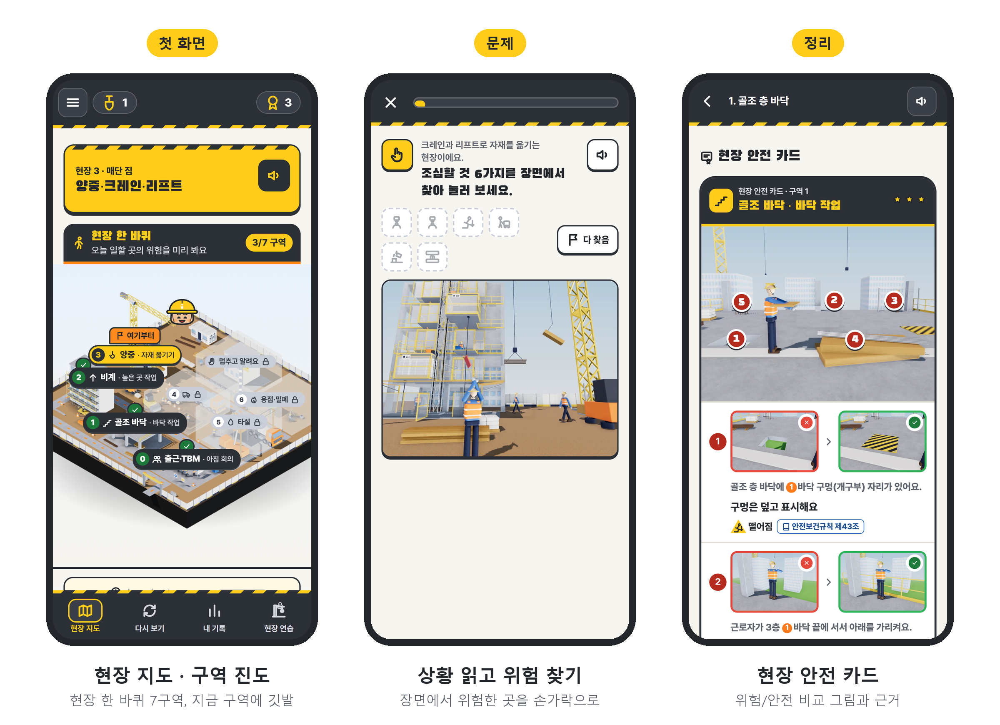
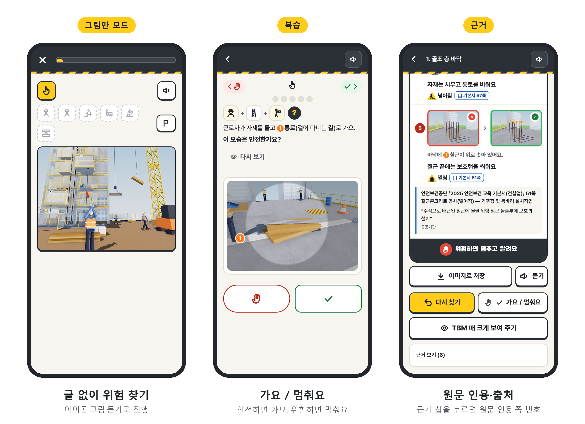
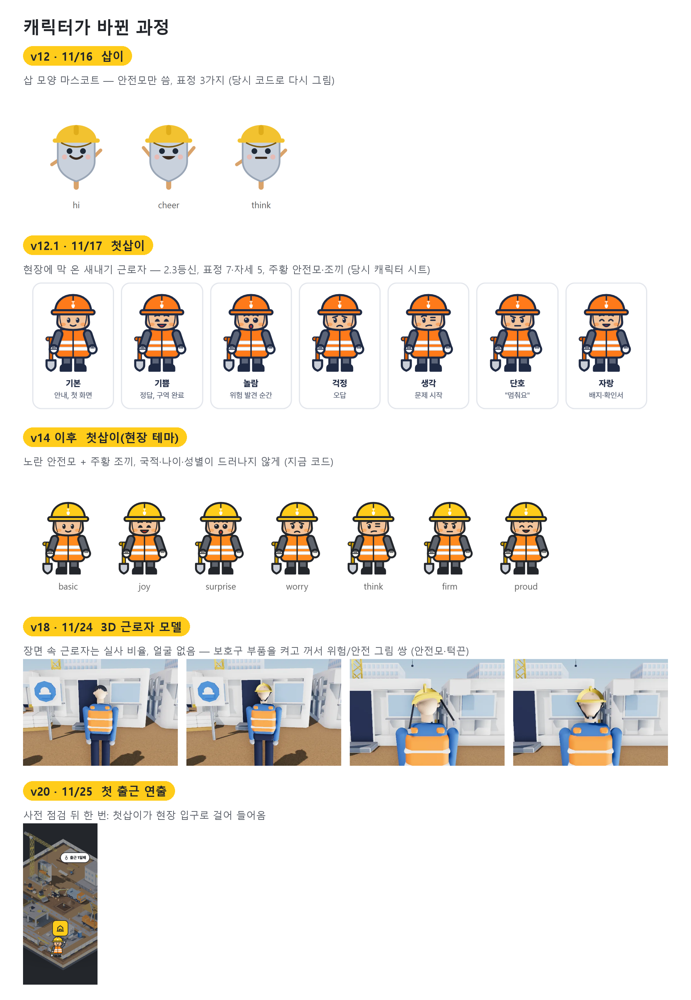
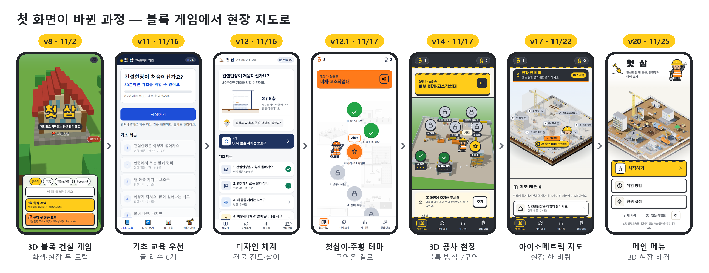
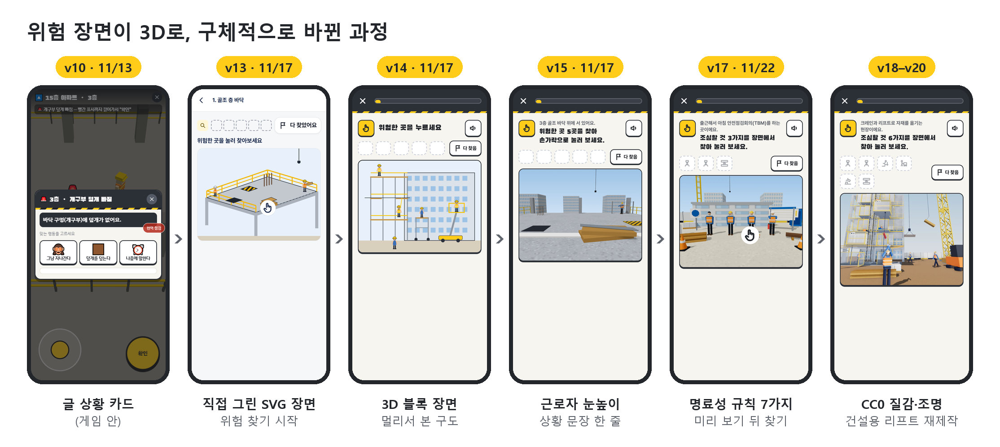

# 첫 삽 — 총정리 (2026-11-25)

건설현장 첫 출근 전, 위험한 곳과 그 이유를 그림으로 미리 익히는 교육 앱

- 배포 주소: https://wldp2003-ctrl.github.io/first-shovel/
- 현재 버전: v20 (2026-11-25 배포)
- 캡스톤 디자인 겸 논문 주제 · 최종 발표 12/7 · 논문 제출 12/11
- 같은 폴더의 다른 글: `1125_앱소개_노션.md`(앱 소개), `1125_단계별_문제.md`(단계별 문제 표)

## 1. 과제 개요

| 항목 | 내용 |
|---|---|
| 과제 이름 | 첫 삽 — 건설현장 신규 근로자를 위한 그림 중심 위험 인지 교육 앱 |
| 무엇을 | 현장 7구역의 위험 31개를 3D 장면에서 직접 찾고, 왜 위험한지와 어떻게 할지를 익히는 휴대폰 웹앱 |
| 누구에게 | 건설현장에 처음 왔거나 근속 6개월 미만인 근로자(일용직 포함), 한국어 글을 읽기 어려운 근로자 |
| 언제 | 출근 전, 현장 대기 중 (구역 하나 1.4–4.8분, 전체 15–28분 — 자동 점검 추정) |
| 어떻게 | 휴대폰 브라우저로 주소를 열면 끝. 설치·로그인 없음, 첫 방문 뒤 인터넷 없이도 됨 |
| 비용 | 0원 (유료 에셋·유료 서비스 0개) |
| 위치 | 법정 안전교육을 대신하지 않는 복습·준비용 |
| 기간 | 2026-10-26 시작, v1–v20, 현재 v20 |

## 2. 추진 배경 및 필요성

### 배경 숫자 (법령·정부 자료만)

| 근거 | 내용 | 출처 |
|---|---|---|
| 건설업 사고사망 | 2025년 재해조사 대상 사고사망자 605명 중 건설업 286명(47.3%) | 고용노동부 보도자료(2026.3.31) |
| 가장 많은 사고 유형 | 전 업종 사고사망 중 떨어짐 249명(41.2%) | 같은 자료 |
| 신규 근로자 교육 | 건설 일용근로자는 건설업 기초안전보건교육 4시간 이상 | 산업안전보건법 시행규칙 별표 4 |
| 교육 내용 | 공사 종류·시공 절차 1시간, 재해 유형별 위험요인·조치 2시간, 안전보건관리체제·권리·의무 1시간 | 같은 규칙 별표 5 |
| 교육 방법 | 1시간 이상은 보호구·화재·피난을 시청각 또는 체험·가상실습으로 | 안전보건교육규정(고시 제2025-77호) 제13조의2 |
| 근로자 권리 | 급박한 위험이 있으면 작업을 중지하고 대피할 수 있다 | 산업안전보건법 제52조 |

### 필요성

- 기초교육은 현장에 들어가기 전 한 번, 4시간이다. 일할 현장의 모습과 위험을 미리 반복해 볼 도구가 적다.
- 근로자에게 작업 중지 권리가 있지만, 무엇이 왜 위험한지 알아봐야 쓸 수 있다.
- 기존 앱은 교육 내용이 어떤 법령·공식 자료에서 왔는지 문장 단위로 보여 주지 않는 경우가 많다 (앱 검토 30개 기준).
- 선행연구의 효과 평가는 만족도 설문이 중심이고, 위험 인지를 사용 전후로 재는 도구가 앱 안에 있는 경우는 드물다.
- 한국어 글을 읽기 어려운 근로자도 현장에 있다.
- 보도로만 확인한 숫자(예: "근속 6개월 미만 사망 82.3%")는 원자료를 못 찾아 여기에 쓰지 않았다.

## 3. 목적 및 목표

### 목적

건설현장 신규 근로자가 출근 전 휴대폰으로 현장의 위험을 미리 보고, 스스로 찾고, 위험할 때 멈추고 알리는 행동까지 익히게 한다.

### 목표와 지금 상태

| 목표 | 기준 | 지금 |
|---|---|---|
| 처음 보는 사람이 안내 없이 끝까지 간다 | 예비 시험 참여자 대부분이 도움 없이 확인서까지 | 자동 점검 통과, 사람 시험 0명 (12/1–4) |
| 글을 못 읽어도 끝까지 간다 | 글자를 모두 가리고 처음부터 확인서까지 | 자동 점검 통과 (누른 곳 84번 모두 그림·아이콘) |
| 교육 문장은 모두 근거가 있다 | 출처 없는 문장 0, 원문 불일치 0 | 0 · 0 (출처 69개, 인용 129조각) |
| 전문가가 내용을 확인한다 | 장면 31개 I-CVI | 검토지 준비, 확인 0 |
| 사용 전후 위험 판별을 잰다 | 사전·사후 그림 점검, 구역별 찾은 비율 | 앱에 있음, 자료 0 |
| 쓰기 쉽다 | SUS 점수 | 앱에 설문 있음, 자료 0 |
| 느린 폰에서도 빨리 뜬다 | 느린 4G·CPU 4배에서 첫 화면 3초 | 3.2초 |
| 접근성 | 자동 검사 위반 0, 누르는 곳 44px 이상 | 0 · 0 |

## 4. 주요 내용

### 앱 화면

- 현장 지도 · 상황 읽고 위험 찾기 · 현장 안전 카드

- 그림만 모드 · 가요 / 멈춰요 · 근거(원문 인용·쪽 번호)

### 흐름

오프닝 → 메인 메뉴 → 소개 4장 → 보기 방식 고르기 → 사전 점검 → 첫 출근 → [구역: 미리 보기 → 상황 읽고 찾기 → 어떻게 할까 → 결과·안전 카드] × 7 → 멈추고 알려요 → 사후 점검 → 사용 설문 → 기초 확인서

### 현장 7구역

| 구역 | 이름 | 위험 | 대표 위험 |
|---|---|---|---|
| 0 | 출근·TBM 장소 | 3 | 안전모 안 씀, 턱끈 풀림, 운동화 |
| 1 | 골조 층 바닥 | 5 | 덮개 없는 개구부, 난간 없는 바닥 끝 |
| 2 | 외부 비계·고소작업대 | 5 | 발판 빈틈, 안전대 안 건 사람 |
| 3 | 양중·크레인·리프트 | 6 | 매단 짐 아래, 리프트 문 열림, 적재하중 초과 |
| 4 | 장비·토공사 | 4 | 굴착기 도는 범위 안 사람, 가파른 흙벽 아래 |
| 5 | 타설·동바리 | 4 | 동바리 휨, 펌프카 붐과 전선 |
| 6 | 용접·밀폐공간·폭염 | 4 | 불티 옆 페인트통, 측정 없이 맨홀 진입, 땡볕 |

### 핵심 기능

| 기능 | 내용 |
|---|---|
| 미리 보기 → 찾기 | 무엇을 찾는지 먼저 알고, 상황 문장을 읽고 장면에서 직접 누름. 이미 안전한 곳(함정)도 있음 |
| 위험/안전 비교 그림 | 같은 구도에서 차이 하나 (31쌍) |
| 어떻게 할까 | 보호구·알리기·멈추기 중 고르기 |
| 현장 안전 카드 | 구역 정리, 이미지 저장, TBM 때 크게 보여 주기 |
| 그림만 모드·듣기 | 설명 글을 숨기고 아이콘·그림·음성으로 |
| 근거 칩 | 누르면 법령·공단 기본서 원문 인용과 쪽 번호 |
| 측정 | 사전·사후 그림 점검, 구역별 찾은 비율·시간, SUS + 자체 5문항, 개인정보 없는 결과 파일 |
| 부록 | 현장 연습(예전 3D 게임, 시제품 — 연구 범위 밖) |

## 5. 차별성

| 앱 | 교육 방식 | 글 없이 | 근거 표시 | 학습 측정 | 무료·설치 |
|---|---|---|---|---|---|
| 건설안전패스 | 없음(이수증 앱) | 확인 못 함 | 없음 | 없음 | 무료, 설치 |
| KNOWRISK (논문) | 영상, 위험요소 찾기 퀴즈 | 확인 못 함 | 관련 법률 영상 | 퀴즈 | 스토어에서 못 찾음 |
| Site Coach | 장면 위험 찾기 게임(영어) | 확인 못 함 | 없음 | 게임 점수 | 2018 이후 업데이트 없음 |
| HazApp | 위험 찾기 + 해결책(영어) | 확인 못 함 | NCCER 제작 | 점수 | 2025년 삭제 |
| 서울시 무번역 그림책 | 지킨/안 지킨 그림 비교 | 그림만 | 서울시 | 없음 | 무료 PDF |
| 첫 삽 | 3D 장면 위험 찾기 + 미리 보기 + 안전 카드 | 그림만 모드 + 듣기 | 문장마다 출처·상태·원문 인용 | 사전·사후 점검, 구역별 비율, SUS | 무료, 설치·로그인 없이 |

- 장면에서 위험을 찾는 방식은 이미 있다. 첫 삽은 기능 하나가 아니라 조합이 다르다.
- 조합: 국내 법령·공단 교재 기반 장면 + 문장별 근거·검증 상태 + 앱 안 사전·사후 측정 + 그림만 모드 + 무료·설치 없음.
- 따라 하기 어려운 부분은 문장 하나하나를 원문과 대조한 기록, 설계 원칙 10가지, 앞으로 모을 효과 자료다.
- 비교는 스토어 설명·논문으로 했고 앱을 설치해 보지 않았다 (판정자 1명).

## 6. 기대 효과

아직 사용자 자료가 없으므로 모두 기대(가설)이고, 예비 시험으로 확인할 것이다.

| 대상 | 기대 효과 | 확인 방법 |
|---|---|---|
| 신규 근로자 | 출근 전에 일할 구역의 위험을 그림으로 미리 봄 | 구역별 찾은 비율·시간 |
| 신규 근로자 | 위험을 보면 멈추고 → 피하고 → 알리는 순서를 기억 | 멈추고 알려요 기록, 자체 문항 3 |
| 글을 읽기 어려운 근로자 | 글 없이 끝까지 진행 | 그림만 모드 참여자 관찰 |
| 반장·관리감독자 | TBM 때 안전 카드를 보여 주며 설명 | 실제 사용 사례 (아직 0) |
| 연구 | 그림 중심 위험 인지 교육의 설계 원칙과 근거 검증 방법을 다른 교육 도구에 쓸 수 있음 | 논문자료 03·06 |
| 비용 | 0원으로 만들고 고칠 수 있음 | 에셋 라이선스 기록 |

## 7. 위험 요소와 대응

| 위험 요소 | 영향 | 대응 | 지금 |
|---|---|---|---|
| 교육 내용이 법령과 다르게 전달됨 | 잘못된 안전 지식 | 문장마다 출처·상태, 원문 자동 대조, 화면엔 원문확인만 | 불일치 0, 전문가 확인 0 |
| 법정 교육으로 오해 | 이수 체계 혼란 | 타이틀·확인서·정보에 "법정 교육 아님" 고지 | 적용 |
| 효과를 증명하지 못함 | 논문 결과 약함 | 사전·사후 점검·SUS를 앱에 넣고 한계를 그대로 씀 | 예비 시험 12/1–4 |
| 사전·사후 문항이 교육 그림과 같음 | 재인 효과가 섞임 | 한계로 쓰거나 새 그림 문항 추가 | 결정 대기 |
| 저사양 폰에서 3D가 느림 | 멈춤·이탈 | 미리 렌더링 그림, 느리면 자동 전환, 첫 실행은 그림 | 첫 화면 3.2초, 지도 fps는 실기기 측정 필요 |
| 글을 못 읽는 사람이 막힘 | 대상 놓침 | 그림만 모드 규칙, 모든 단추 아이콘, 듣기 | 자동 통과, 음성은 한국어만 |
| 개인정보 | 연구 윤리 | 이름·연락처·기기 정보 저장 안 함, 무작위 번호만 | 적용, IRB 여부 확인 필요 |
| 저작권 | 배포 불가 | 직접 만든 그림·코드 모델, CC0만, 글꼴 OFL, 기록 | 기록 빠짐 0 |
| 외부 서비스가 끊김 | 앱 안 됨 | 외부 요청 0, 오프라인 동작 | 적용 (배포는 GitHub Pages) |
| 누가 앱을 알려 주나 | 쓰는 사람 없음 | TBM 큰 글씨 화면, 현장 출입구 QR 포스터 | 만듦, 현장 사용 0 |
| 일정 | 발표·논문 지연 | 기능 동결 11/30 23:59, 뒤로는 버그·문서만 | 진행 중 |
| AI 도구 사용 | 저작·검증 책임 | 날짜별 AI가 한 일·사람이 정한 일 기록 | `docs/AI_사용기록.md` |

## 8. 캐릭터 발전 과정

| 버전 | 캐릭터 | 바꾼 이유 |
|---|---|---|
| v12 (11/16) | 삽이: 삽 모양 마스코트, 안전모, 표정 3가지 | 앱다운 디자인 체계의 첫 캐릭터 |
| v12.1 (11/17) | 첫삽이: 현장에 막 온 새내기 근로자, 2.3등신, 표정 7·자세 5, 주황 안전모·조끼 | 근로자와 함께 배우는 동료로, 상황마다 표정(오답은 걱정, 정답은 기쁨) |
| v14 이후 | 노란 안전모 + 주황 조끼, 국적·나이·성별이 드러나지 않게 | 현장 테마, 안전모 노랑을 브랜드 색으로 |
| v18 (11/24) | 장면 속 근로자는 따로 3D 코드 모델: 실사 비율(키 약 1.72m), 얼굴 없음, 보호구를 부품으로 켜고 끔 | 위험/안전 비교 그림을 같은 구도에서 차이 하나로 만들기 위해 |
| v20 (11/25) | 첫 출근 연출: 첫삽이가 현장 입구로 걸어 들어옴 (처음 한 번) | 사전 점검에서 현장으로 넘어가는 순간 |

- 첫삽이(안내 캐릭터)와 장면 속 근로자(3D 모델)는 일부러 다르게 그렸다. 안내하는 동료와 판단 대상을 헷갈리지 않게.

## 9. 구현 과정

### 첫 화면이 바뀐 과정

### 위험 장면이 3D로, 구체적으로 바뀐 과정

### 단계별 정리

| 시기 | 버전 | 무엇을 바꿨나 | 왜 |
|---|---|---|---|
| 10/26–11/2 | v1–v8 | 3D 블록 건설 게임 "지예건설", 학생·현장 두 트랙, 미니게임, PWA 배포 | 에이전트 앱 과제에서 시작, v7부터 교수님 권유로 캡스톤 주제 |
| 11/13 | v9–v10.1 | 신규 근로자 한 트랙, 한국어 우선, 결과마다 무슨 작업·왜 위험·근거 | 목적 재정의 |
| 11/16 | v11–v11.2 | 처음부터 다시 설계: 기초 레슨 6개·사전·사후 점검, 게임은 현장 연습으로 분리, 근거 검증 체계 | 짧은 교육이 먼저, 내용 신뢰 |
| 11/16–11/17 | v12–v13 | 디자인 체계·캐릭터, 현장 위험 찾기 7구역(직접 그린 SVG 장면) | 교수님 피드백: 현장 사진처럼 직관적으로, 외국인을 위한 그림, 게임 형식 |
| 11/17 | v14–v15 | 3D 공사 현장 지도(블록), 그림과 글 함께, 근로자 눈높이 3D 장면·상황 문장 | 교수님 말씀: 그림을 글과 함께, 더 입체적으로 |
| 11/22 | v16–v17 | 명료성 규칙 7가지로 장면 다시 만듦, 먼저 알고→찾고→정리, 안전 카드, 아이소메트릭 지도 | 무엇이 위험한지 한눈에 |
| 11/24 | v18–v19.4 | 코드 모델·CC0 질감·조명, 미리 렌더링, 건설용 리프트 재제작(별표 3 기준), 위험 31개 | 0원으로 3D 품질, 저사양 대응 |
| 11/24–11/25 | v20 | 메인 메뉴·소개·설정, 자체 점검 7라운드, 앱 안 설문, 그림만 모드 규칙, 뒤로 가기, TBM 큰 글씨, QR 포스터 | 심사위원 5관점 점검, 예비 시험 준비 |

### 만드는 방법

| 항목 | 내용 |
|---|---|
| 앱 형태 | 서버 없는 웹앱(PWA), GitHub Pages 배포, 서비스 워커로 오프라인 |
| 화면 | 프레임워크 없이 직접 만든 화면 코드, 직접 그린 SVG 아이콘 |
| 3D | three.js(MIT). 건물·장비·근로자·리프트를 코드로 만들고 질감은 CC0만 |
| 장면 제작 | 위험 문장(scenes.json) → 같은 자리에 위험 부품·안전 부품을 두고 켜고 꺼서 그림 쌍 → 누를 곳은 3D 위치에서 자동 계산 → 미리 렌더링(WebP) |
| 근거 | sources.json에 출처·원문 인용, 원문 PDF와 자동 대조 (PDF는 공개 저장소에 안 올림) |
| 점검 | 자동 점검 도구로 136화면 × 2모드 플레이, 접근성(axe-core), 성능(Lighthouse, 느린 4G·CPU 4배), 색약 흉내, 음성 없는 기기 흉내 |
| AI 도구 | 코드 작성·측정·문서 초안에 AI(오르카·Claude) 사용. 무엇을 만들지·교육 방향·최종 확인은 연구자 |

### 자체 점검 7라운드 결과

| 라운드 | 주제 | 대표 결과 |
|---|---|---|
| 1 | 성능·접근성 | 첫 화면 23.1초 → 3.1초, 받는 양 5.7MB → 0.65MB, 접근성 위반 151 → 0 |
| 2 | 연구 도구 | 앱 안 SUS·자체 설문, 진행자 안내서·동의서, 장면 31개 전문가 검토지 |
| 3 | 그림만 모드 | 찾기 화면 한글 0자, 다시 보기 597자 → 103자 |
| 4 | 이동·안내 | 안드로이드 뒤로 가기, 메뉴 단추, 게임 방법 7장, 첫 출근 |
| 5 | 격리·현장 연계 | 현장 연습 외부 요청 11 → 0, 지도 이름표 겹침 0, TBM 큰 글씨, QR 포스터, 색약 |
| 6 | 논문자료 | 논문자료 01–10 초안, 위험 3-6 정답 없는 문제 버그 고침 |
| 7 | 음성·정리 | 한국어 음성 없는 기기 안내, 확인필요 3건 해결 |

- 단계별 문제와 상태(고침 28 · 남음 18 · 판정 5)는 `1125_단계별_문제.md`

## 10. 근거 자료

| 등급 | 종류 | 출처 수 |
|---|---|---|
| 1 | 법률·고용노동부령·고시 | 38 |
| 2 | 안전보건공단·고용노동부·서울시 | 27 |
| 3 | 국가건설기준(KCS)·KS 인증심사기준 | 4 |
| 합계 | | 69 |

- 가장 많이 쓴 자료: 안전보건공단 「2025 안전보건 교육 기본서(건설업)」 — 출처 24개, 레슨 63곳·장면 95곳
- 상태가 붙은 문장 167개 모두 원문확인, 전문가확인 0개
- 직접 넣은 원문 파일별 쓰인 곳은 `1125_앱소개_노션.md` ⑦

## 11. 앞으로 할 일

| 날짜 | 할 일 |
|---|---|
| 11/30까지 | 남은 결정 2건(사전·사후 새 그림 문항, 3-6 "피해요" 선택지) · 기능 동결 11/30 23:59 |
| 12/1–12/4 | 전문가 검토(장면 31개 CVI), 예비 시험 5–8명 |
| 12/5–12/6 | 결과 분석(모으기 도구 있음), 발표 자료 |
| 12/7 | 최종 발표 |
| 12/8–12/11 | 논문 작성·제출 (논문자료 01–10 초안 있음) |

지금 약한 점: 사용자 자료 0 · 전문가 확인 0 · 음성은 한국어만 · 도입 경로 미정

## 12. 교수님께 여쭤볼 것

- 예비 시험 대상(대리 참여자 가능 여부)과 인원(5–8명)
- IRB 심의 필요 여부
- 전문가 검토자 소개 (3–5명)
- 논문 형식·분량, 장 구성
- 현장 연습(예전 3D 게임)을 남길지
- 그림만 모드를 설정으로 다시 넣은 것(v14에 뺐던 것)을 그대로 둬도 될지

## 숫자 확인

| 숫자 | 출처 |
|---|---|
| 605명·286명(47.3%)·떨어짐 249명(41.2%) | 고용노동부 보도자료 2026.3.31 (sources.json moel-0331), 47.3%는 286/605 |
| 7구역·31위험·7함정·31쌍 | data/scenes.json, assets/scenes |
| 출처 69(38·27·4), 원문확인 167, 전문가확인 0, 인용 129조각 | data/sources.json, lessons·scenes.json status, tools/check-sources.py |
| 첫 화면 23.1 → 3.2초, 접근성 151 → 0 | docs/점검/측정표.md, 측정_r7.json |
| 소요 시간 1.4–4.8분·15–28분 | smoke-v13 4번 (추정) |
| 앱 검토 1,269개 → 30개 | docs/차별점_분석.md 1.2절 |
| 버전 v1–v20 | CHANGELOG.md |
| 캐릭터·화면 사진 | 각 버전 당시 캡처(화면캡처_v11–v20, shots), v12 삽이는 당시 코드(git 826b9e6)로 다시 그림 |
